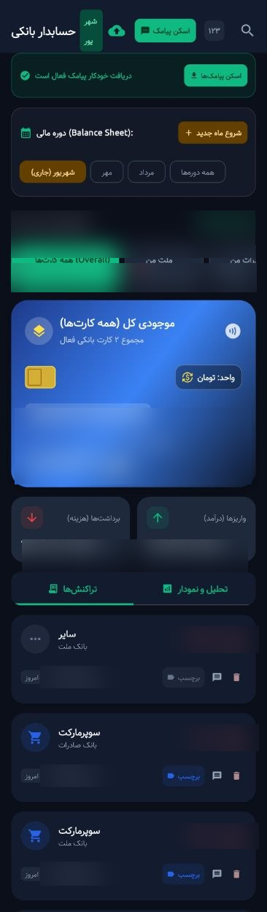
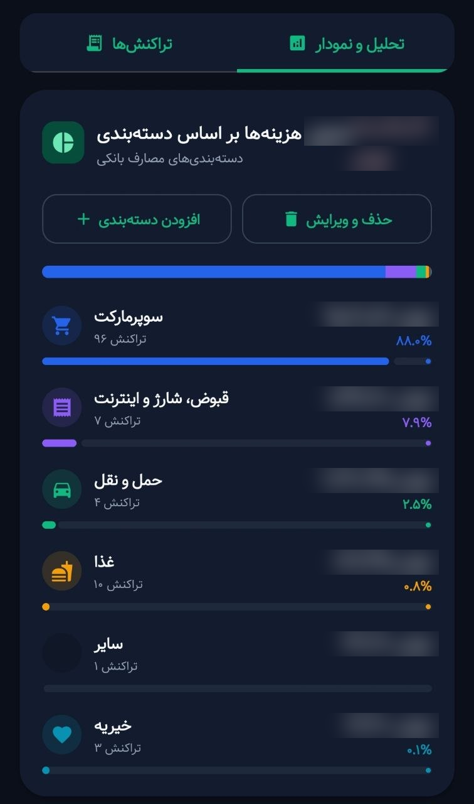
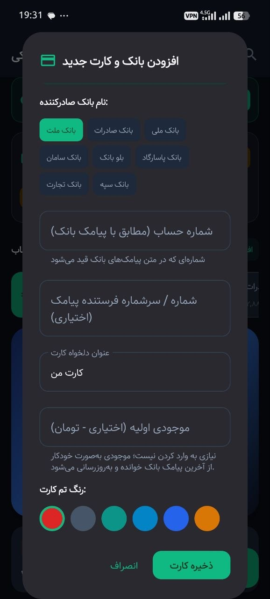
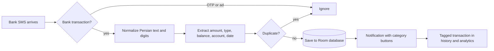

# Bank Tracker

An Android app that turns Iranian bank SMS messages into a clean, categorized spending history. It reads each transaction SMS the moment it arrives, works out the amount, type and balance, and asks you to tag it with one tap from the notification.

  
  
  

Amounts and account numbers blurred.

<!-- Replace with a 10 to 15 second GIF: SMS arrives, notification shows, tap a category, it appears in the history. -->

## Why I built it

Iranian banks send a text for every transaction, but the texts are inconsistent across banks, mix Persian and Latin digits, and arrive alongside OTPs and marketing. Most budgeting apps cannot read them. I wanted my spending history to build itself from those messages.

## What it does

- **Reads bank SMS in real time.** A broadcast receiver catches each new message and keeps only real transactions.
- **Filters the noise.** One-time passwords, login codes and informational messages are recognized and skipped.
- **Parses messy formats.** Normalizes Persian and Arabic characters and digits, then extracts amount, debit or credit, balance, account and date across several bank formats.
- **One-tap tagging.** Each transaction triggers a notification with category buttons, so it is categorized without opening the app.
- **Imports history.** Scans the existing inbox, matches messages to your saved cards and skips duplicates.
- **Shows where money goes.** Spending by category, monthly views on the Persian (Jalali) calendar, and Rial/Toman conversion.
- **Keeps data on the phone.** The app has no internet permission, so nothing can leave the device. JSON export and import handle backup.

## How it works

## Tech

Kotlin · Jetpack Compose · Material 3 · Room · Android SMS broadcast receivers · notification actions

## How I built it

This is an **AI-assisted product build**, made with Google AI Studio. I defined the requirements, designed the flows and parsing rules from real bank messages, tested it on my own phone, and iterated on every failure case until it handled the formats I receive.

## Run it

1. Open the project in Android Studio.
2. Remove `signingConfig = signingConfigs.getByName("debugConfig")` from `app/build.gradle.kts`.
3. Run on a device and grant SMS and notification permissions.

## Privacy

The app does not request internet access. SMS are read on the device and transactions stay in its local database.
